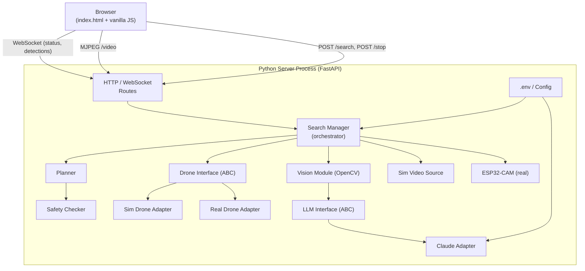

# Design Document

## Overview

Drone Finder is a single-process Python application that orchestrates an indoor drone search, or simulates one end-to-end when hardware is unavailable. A user types what they are looking for; the system generates a lawnmower flight plan, commands the drone (real or simulated) to sweep the area, analyses the video feed with OpenCV, and confirms detections via Claude. Results and live status appear in a browser-based UI served by the same process.

**Design philosophy for this hackathon**: one server process, no database, no build step, `pip install` + copy `.env`. The simulation path is the primary development target; hardware integration plugs in without touching business logic.

---

## Architecture



**Single process, three communication channels to the browser:**

| Channel | Direction | Purpose |
|---|---|---|
| `POST /search`, `POST /stop` | Browser → Server | Commands |
| `WebSocket /ws` | Server → Browser | Status log messages, detection events, result |
| `GET /video` | Server → Browser | MJPEG video stream |

---

## Components and Interfaces

### Search Manager
The central orchestrator. Owns the current search lifecycle: starts/stops searches, drives the flight plan execution loop, feeds frames to the Vision Module, routes candidate events to the LLM, and publishes all status messages over the WebSocket.

**Key responsibilities:**
- Start/stop search sessions
- Execute flight plan step-by-step, yielding between moves so the event loop stays responsive
- Feed Video_Stream frames to Vision_Module at ≥15 fps
- React to candidate-found events: call LLM_Interface.confirm(), branch on result
- Publish structured events to all connected WebSocket clients
- Handle all error paths (drone command failures, video interruptions, LLM timeouts)

### Planner
Pure function: `generate_plan(query: str, area: SearchArea) -> FlightPlan`.

Reads `SearchArea` from config. Generates a lawnmower sweep pattern: row-by-row bidirectional traversal of the grid, quantised to `step_size` metres. Returns a `FlightPlan` (list of `Move` objects) always starting with `takeoff` and ending with `land`.

### Safety Checker
Pure function: `validate(plan: FlightPlan, area: SearchArea) -> ValidationResult`.

Checks every move stays within `SearchArea` bounds and that total estimated flight time ≤ 300 seconds. Returns the plan unchanged on pass; returns a `ValidationResult(ok=False, reason=...)` on fail.

### Drone Interface (ABC)

```python
from abc import ABC, abstractmethod

class DroneInterface(ABC):
    @abstractmethod
    async def takeoff(self) -> None: ...
    @abstractmethod
    async def land(self) -> None: ...
    @abstractmethod
    async def move(self, direction: Direction, distance_m: float) -> None: ...
    @abstractmethod
    async def turn(self, angle_deg: float) -> None: ...
    @abstractmethod
    async def hover(self, duration_s: float) -> None: ...
    @abstractmethod
    async def stop(self) -> None: ...
```

**SimDroneAdapter** — all methods log the call to the status channel and return immediately.

**RealDroneAdapter** — sends JSON commands to the ESP32 over HTTP/UDP, times out after 5 s, raises `DroneCommandError` on failure.

### LLM Interface (ABC)

```python
from abc import ABC, abstractmethod

class LLMInterface(ABC):
    @abstractmethod
    async def confirm(self, image_bytes: bytes, query: str) -> tuple[bool, str]: ...
    @abstractmethod
    async def describe(self, image_bytes: bytes, query: str) -> str: ...
```

**ClaudeAdapter** — encodes image as base64, calls `anthropic.Anthropic().messages.create()` with the vision model. Loads API key from config. Raises `LLMError` if key missing or API returns an error.

### Vision Module
Open-vocabulary detector using YOLO-World. `analyse_frame(frame: np.ndarray, query: str) -> FrameResult`.

```python
from ultralytics import YOLOWorld
```

Before each search, `model.set_classes([query])` is called to set the target class to exactly what the user typed — no fixed class list required. The model runs on CPU and natively produces bounding boxes and confidence scores for each detected instance.

Detection runs at 2–5 fps on CPU, which is acceptable for the demo. The MJPEG stream continues rendering at 15 fps using the last known frame and bounding box between detection cycles. Maintains a 3-frame sliding window. Emits `CandidateFoundEvent` when 3 consecutive frames all score ≥ 0.7. The Claude confirmation step is unchanged.

### Sim Video Source
A directory of JPEG images (`sim_images/`). Maintains a mapping `{grid_cell: image_path}`. Returns the correct image bytes for the drone's current grid position. Cycles to a "no item" image when the drone is outside the target cell.

### Config Loader
`load_config() -> AppConfig` using `python-dotenv`. Raises a `ConfigError` naming the missing key if any required key is absent. Called once at startup; result injected everywhere it is needed.

---

## Data Models

```python
from dataclasses import dataclass, field
from enum import Enum
from typing import Optional

class Direction(str, Enum):
    FORWARD = "forward"
    BACKWARD = "backward"
    LEFT = "left"
    RIGHT = "right"

class MoveType(str, Enum):
    TAKEOFF = "takeoff"
    LAND = "land"
    MOVE = "move"
    TURN = "turn"
    HOVER = "hover"
    STOP = "stop"

@dataclass
class Move:
    type: MoveType
    direction: Optional[Direction] = None   # move only
    distance_m: Optional[float] = None      # move only
    angle_deg: Optional[float] = None       # turn only
    duration_s: Optional[float] = None      # hover only

@dataclass
class SearchArea:
    width_m: float
    depth_m: float

@dataclass
class FlightPlan:
    moves: list[Move]
    area: SearchArea
    query: str

@dataclass
class ValidationResult:
    ok: bool
    reason: str = ""

@dataclass
class FrameResult:
    detected: bool
    confidence: float = 0.0
    bbox: Optional[tuple[int,int,int,int]] = None  # x, y, w, h (pixels)

@dataclass
class CandidateFoundEvent:
    best_frame_bytes: bytes
    bbox: tuple[int,int,int,int]
    confidence: float

@dataclass
class AppConfig:
    mode: str                    # "sim" | "real"
    search_area: SearchArea
    sim_images_dir: str
    sim_target_cell: tuple[int,int]
    anthropic_api_key: str
    llm_provider: str            # "claude"
    esp32_address: str           # only used in real mode
    voice_input_enabled: bool
    step_size_m: float           # grid cell size for sweep

# WebSocket message envelope
@dataclass
class WSMessage:
    type: str   # "status" | "detection" | "result" | "error"
    payload: dict
```

---

## Video Streaming Approach

MJPEG over a plain HTTP endpoint is the simplest cross-platform approach — no additional WebSocket frame handling, works in every browser `` tag with no JS.

```
GET /video  →  multipart/x-mixed-replace; boundary=frame
              --frame\r\nContent-Type: image/jpeg\r\n\r\n<bytes>\r\n
              --frame\r\n...
```

**Real mode**: pulls MJPEG frames from the ESP32-CAM URL, re-streams them.  
**Sim mode**: `SimVideoSource.get_frame()` returns JPEG bytes for the current grid cell; the route loops at ~15 fps using `asyncio.sleep(1/15)`.

The `` tag in `index.html` requires no JS beyond pointing the `src` attribute.

Detection box overlay is drawn server-side onto the frame using `cv2.rectangle()` before encoding to JPEG, so no canvas manipulation is needed in the browser.

---

## Simulation Mode Design

Simulation replaces two hardware dependencies without touching any other component:

| Real mode | Sim mode |
|---|---|
| `RealDroneAdapter` | `SimDroneAdapter` |
| ESP32-CAM MJPEG stream | `SimVideoSource` |

**SimDroneAdapter behaviour:**
1. Accepts every `DroneInterface` call.
2. Logs `[SIM] <command>(<params>)` to the WebSocket status channel.
3. Returns immediately (no sleep, to keep demo fast — can add configurable delay).
4. Tracks current simulated position internally so `SimVideoSource` can query it.

**SimVideoSource behaviour:**
1. Reads JPEG files from `sim_images/` at startup.
2. Config specifies `SIM_TARGET_CELL=1,2` (column, row of the grid cell that contains the item).
3. `get_frame(cell: tuple[int,int]) -> bytes` returns:
   - `sim_images/target.jpg` when `cell == sim_target_cell`
   - `sim_images/empty_N.jpg` (round-robins) otherwise
4. Frame is updated within 500 ms of the drone entering a new cell (satisfied trivially since it's synchronous).

**Simulation label**: The `/video` route appends a `SIMULATION` text overlay using `cv2.putText()` when `config.mode == "sim"`.

---

## Technology Choices

| Choice | Rationale |
|---|---|
| **Python 3.11+** | Team familiarity, rich ecosystem, no compilation step |
| **FastAPI + uvicorn** | Async from the start (needed for concurrent WebSocket + video + drone commands), auto-generates OpenAPI docs for free, `pip install fastapi uvicorn` |
| **WebSocket (FastAPI built-in)** | Bidirectional real-time status; simpler than polling |
| **MJPEG stream** | Zero-JS video in the browser; works in every `` tag; no codec negotiation |
| **YOLO-World (`ultralytics`)** | Open-vocabulary object detection via `model.set_classes([query])`; single `pip install ultralytics`; runs on CPU, produces bounding boxes + confidence scores natively; no fixed class list |
| **OpenCV (`opencv-python-headless`)** | Bounding-box drawing (`cv2.rectangle`), SIMULATION label overlay (`cv2.putText`), MJPEG frame encode/decode; headless variant has no GUI dependency |
| **anthropic Python SDK** | Official SDK, straightforward vision API, `pip install anthropic` |
| **python-dotenv** | One-line `.env` loading, standard for Python projects |
| **Vanilla HTML/JS** | No build step; teammate opens `index.html` served by FastAPI static files; no Node.js required |
| **No database** | All state in Python dicts/dataclasses in the single process; gone on restart, which is fine for a hackathon demo |
| **asyncio throughout** | Drone commands, LLM calls, and video streaming all run concurrently without threads |

---

## File and Directory Structure

```
drone-finder/
├── .env.example              # Template with all required keys + comments
├── .env                      # Actual config (git-ignored)
├── README.md                 # Setup + run instructions (numbered steps)
├── requirements.txt          # Pinned deps: fastapi, uvicorn, opencv-python-headless,
│                             #   anthropic, python-dotenv, websockets, ultralytics
│
├── sim_images/               # JPEG images for simulation mode
│   ├── target.jpg            # Image containing the item
│   ├── empty_1.jpg
│   └── empty_2.jpg
│
├── app/
│   ├── __init__.py
│   ├── main.py               # FastAPI app, routes, startup
│   ├── config.py             # load_config() → AppConfig
│   ├── search_manager.py     # Search orchestration, WebSocket broadcast
│   │
│   ├── planner/
│   │   ├── __init__.py
│   │   ├── planner.py        # generate_plan()
│   │   └── safety_checker.py # validate()
│   │
│   ├── drone/
│   │   ├── __init__.py
│   │   ├── interface.py      # DroneInterface ABC
│   │   ├── sim_adapter.py    # SimDroneAdapter
│   │   └── real_adapter.py   # RealDroneAdapter
│   │
│   ├── vision/
│   │   ├── __init__.py
│   │   ├── vision_module.py  # analyse_frame(), confidence window
│   │   └── sim_video.py      # SimVideoSource
│   │
│   ├── llm/
│   │   ├── __init__.py
│   │   ├── interface.py      # LLMInterface ABC
│   │   └── claude_adapter.py # ClaudeAdapter
│   │
│   └── models.py             # All dataclasses / enums
│
├── static/
│   └── index.html            # Single-file frontend (HTML + CSS + JS inline)
│
└── tests/
    ├── test_planner.py
    ├── test_safety_checker.py
    └── test_vision_module.py
```

---

## Correctness Properties

*A property is a characteristic or behavior that should hold true across all valid executions of a system — essentially, a formal statement about what the system should do. Properties serve as the bridge between human-readable specifications and machine-verifiable correctness guarantees.*

### Property 1: Valid search requests reach the Planner unchanged

*For any* non-empty, non-whitespace-only search request string, submitting it to the system should result in the Planner receiving exactly that string as its query parameter.

**Validates: Requirements 1.2**

### Property 2: Whitespace-only inputs are rejected without starting a search

*For any* string composed entirely of whitespace characters (including the empty string), submitting it as a search request should not trigger the Planner and should leave the system in its idle state.

**Validates: Requirements 1.3**

### Property 3: Flight plan moves are all valid primitives

*For any* non-empty search request string and any valid SearchArea dimensions, every Move in the generated FlightPlan should have a MoveType that is one of {takeoff, land, move, turn, hover, stop}.

**Validates: Requirements 2.1**

### Property 4: Sweep pattern covers every cell exactly once

*For any* SearchArea with positive width and depth and any step size, the Sweep_Pattern generated by the Planner should visit every grid cell exactly once — no cell omitted, no cell visited more than once.

**Validates: Requirements 2.2**

### Property 5: Safety checker rejects out-of-bounds plans

*For any* FlightPlan containing at least one Move that would displace the drone outside the configured SearchArea boundary, the Safety_Checker should return a ValidationResult with ok=False.

**Validates: Requirements 3.1**

### Property 6: Safety checker rejects over-time plans

*For any* FlightPlan whose sum of estimated move durations exceeds 300 seconds, the Safety_Checker should return a ValidationResult with ok=False.

**Validates: Requirements 3.2**

### Property 7: Valid plans are returned unchanged by the safety checker

*For any* FlightPlan that stays within SearchArea bounds and whose total estimated duration is ≤ 300 seconds, the Safety_Checker should return a ValidationResult with ok=True and return the identical plan to the caller.

**Validates: Requirements 3.4**

### Property 8: Vision Module confidence scores are always in range

*For any* video frame input, every FrameResult returned by the Vision_Module should have a confidence score in the range [0.0, 1.0].

**Validates: Requirements 7.1**

### Property 9: Candidate-found event is emitted only after 3 consecutive high-confidence frames

*For any* sequence of frames where all 3 most recent consecutive frames have confidence ≥ 0.7, the Vision_Module should emit exactly one candidate-found event carrying the frame with the highest confidence score among those 3 (the earliest frame in case of a tie).

**Validates: Requirements 7.2**

### Property 10: Sub-threshold frame resets the detection window

*For any* sequence of frames where any frame has confidence < 0.7, the Vision_Module should not emit a candidate-found event from that sequence, regardless of the scores of adjacent frames.

**Validates: Requirements 7.3**

### Property 11: Status log retains at least the 200 most recent messages

*For any* sequence of N status messages where N > 200, the Status_Log should contain at least the 200 most recent messages and should not contain any messages older than the 200th most recent.

**Validates: Requirements 13.3**

---

## Error Handling

| Failure scenario | Response |
|---|---|
| Config key missing at startup | `ConfigError` names the key; process exits non-zero before any network/hardware call |
| Safety check fails | Planner does not execute plan; error appended to Status_Log |
| Drone command fails | Log operation + reason; issue `land` command; abort search |
| Land command after failure takes >10 s | Log critical "drone may be uncontrolled" to Status_Log |
| Stop button: stop not acked within 500 ms | Log stop-failed error; retain last known state |
| Stop button: land not acked within 10 s | Log land-failed error |
| Video stream interrupted >3 s | Log "Video lost" warning; if airborne, issue `hover` command |
| LLM call fails or times out (10 s) | Log confirmation-timeout event; resume Flight_Plan |
| LLM API key missing | Abort search session; display error in UI |
| `describe` fails on found item | Display Result_Card with "description unavailable" fallback |
| Drone fails to land within 30 s after sweep | Display landing-failure error; preserve Result_Card |

All errors are published as `WSMessage(type="error", payload={...})` over the WebSocket so the browser can render them in the Status_Log without polling.

---

## Testing Strategy

**Unit tests** (pytest, no external services):
- `test_planner.py` — tests `generate_plan()` with various area sizes; verifies move types and sweep coverage
- `test_safety_checker.py` — tests `validate()` with in-bounds/out-of-bounds plans and over-time plans
- `test_vision_module.py` — tests confidence window logic with synthetic FrameResult sequences

**Property-based tests** (pytest + Hypothesis):
- One property test per Correctness Property above (Properties 1–11)
- Minimum 100 iterations each
- Each test is tagged with a comment: `# Feature: drone-finder, Property N: <property_text>`
- Pure logic (Planner, Safety_Checker, Vision_Module confidence window) is tested without hardware or network

**Integration tests** (simulation mode, manual during hackathon):
- Start server in sim mode, POST /search, verify WebSocket messages arrive, video feed renders, Result_Card appears
- Verify Stop_Button cancels in-progress search
- Verify "SIMULATION" label appears on video feed

**Recommended PBT library**: `hypothesis` — `pip install hypothesis`

Property tests run with `pytest tests/` (single execution, no watch mode needed).

No integration tests are automated — the team verifies the sim demo manually before hardware integration.
